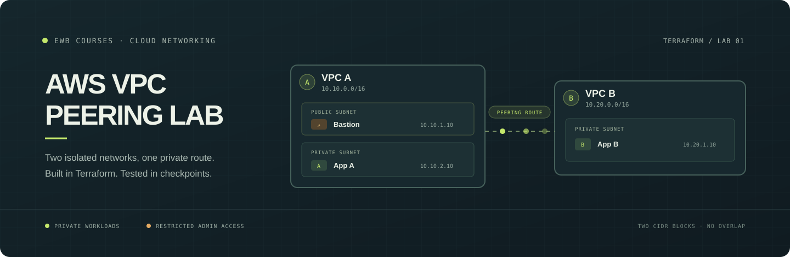

<div align="center">
  
  <h1>AWS VPC Peering Lab</h1>
  <p><strong>Build two isolated AWS networks, inspect the boundary, then connect them with Terraform.</strong></p>
  <p>
    <a href="https://github.com/subhashdoc234xyz/CLOUD-COMPUTINGV2">Source repository</a>
    · <a href="docs/architecture.md">Architecture</a>
    · <a href="docs/runbook.md">Full runbook</a>
    · <a href="web/index.html">Interactive showcase source</a>
  </p>
</div>

This repository implements the EWB Courses student VPC peering assignment as repeatable Terraform configuration. It provisions two non-overlapping VPCs, three subnets, a bastion host, two private test instances, security groups, route tables, and an optional VPC peering connection.

## License

The project source code and project-authored documentation are released under the [MIT License](LICENSE). The included EWB Courses workbook PDF is assignment reference material and is not relicensed by this repository; its original copyright and terms remain with its respective owner.

> **Current account limitation:** Terraform initialization, formatting, and validation succeeded. The AWS account used for the lab currently has an organization policy that explicitly denies `ec2:DescribeAvailabilityZones` and `ec2:DescribeImages`, so Terraform cannot complete its plan. Use an AWS lab account that allows the required EC2/VPC actions, or ask its organization administrator to resolve the policy restriction. An IAM permission change inside the account cannot override an organization-level explicit deny.

## What you will build

| Component | Configuration | Role |
| --- | --- | --- |
| VPC A | `10.10.0.0/16` | Bastion and App A |
| Public subnet | `10.10.1.0/24` | Bastion entry point and internet gateway route |
| Private subnet A | `10.10.2.0/24` | Private App A instance |
| VPC B | `10.20.0.0/16` | Private App B network |
| Private subnet B | `10.20.1.0/24` | Private App B instance |
| Bastion | `10.10.1.10` | SSH entry restricted to your public IPv4 `/32` |
| App A | `10.10.2.10` | Private connectivity test host in VPC A |
| App B | `10.20.1.10` | Private connectivity test host in VPC B |

### How the network test works

1. **Baseline:** `enable_peering = false`. The VPCs are separate and have no cross-VPC routes. The App A to App B ping should fail.
2. **Connect:** set `enable_peering = true`. Terraform creates and accepts a same-account peering connection, then adds routes in the relevant route tables.
3. **Verify:** connect through the bastion and repeat the ping. The private instances should communicate over the peering path without public IP addresses.
4. **Recover:** temporarily remove the destination ICMP rule, observe the failure, restore the rule, and confirm connectivity returns.

The public route table receives a peering route as well, so the bastion can open the SSH hop to App B. The VPC B private route table provides the return path. See the [architecture notes](docs/architecture.md) and [runbook](docs/runbook.md) for the full walkthrough and evidence checklist.

## Requirements

- Terraform `>= 1.5.0`
- AWS CLI v2
- An AWS account and selected Region where the account policy allows the required EC2 and VPC actions
- An existing EC2 key pair named `ewb-lab` in the selected Region; keep its private key on your computer
- Your current public IPv4 address in CIDR `/32` form for bastion SSH access

The project defaults to `ap-south-1` (Mumbai), matching the workbook example. Use a different Region only if your account/lab supports it, and make sure the key pair exists there. The AWS project account used during development was assigned `ap-southeast-2` (Sydney); its organization policy currently blocks the EC2 lookups described above.

## Configure AWS credentials (Windows PowerShell example)

The following example uses AWS CLI console login with a source profile named `vpc-lab` and a Terraform-compatible credential-process profile. If you already have valid profiles, adapt the profile names and Region.

```powershell
# Sign in if your vpc-lab session is not already active.
aws login --profile vpc-lab --region ap-southeast-2

# Configure the source profile Region and bridge its temporary credentials for Terraform.
aws configure set region ap-southeast-2 --profile vpc-lab
aws configure set credential_process "aws configure export-credentials --profile vpc-lab --format process" --profile vpc-lab-terraform
aws configure set region ap-southeast-2 --profile vpc-lab-terraform

# Confirm the identity, then select the profile for Terraform in this PowerShell window.
aws sts get-caller-identity --profile vpc-lab-terraform
$env:AWS_PROFILE = "vpc-lab-terraform"
```

If AWS returns an explicit Service Control Policy (SCP) denial, stop here and ask the AWS organization/lab administrator for an allowed account or policy. Retrying with a different IAM profile does not bypass an SCP deny.

## Configure the Terraform inputs

From the repository root, create your local variables file:

```powershell
Copy-Item .\terraform.tfvars.example .\terraform.tfvars
notepad .\terraform.tfvars
```

Set values for your lab account. For the Sydney project account, the file would look like this, except you must replace the name and IP with your own values:

```hcl
aws_region        = "ap-southeast-2"
student_name      = "Your Name"
my_public_ip_cidr = "YOUR_PUBLIC_IPV4/32"
key_pair_name     = "ewb-lab"
instance_type     = "t3.micro"
enable_peering    = false
```

Replace `YOUR_PUBLIC_IPV4/32` with your actual internet-facing IPv4 address plus `/32`. Do not use the documentation example `203.0.113.10/32` as your real address. The `.gitignore` excludes `terraform.tfvars`, Terraform state, and saved plan files; do not commit credentials or private keys.

## Initialize, validate, and preview

Run these from the repository root after confirming that AWS credentials, Region, and inputs are correct:

```powershell
terraform init
terraform fmt -check
terraform validate
terraform plan -var-file="terraform.tfvars" -out="baseline.tfplan"
terraform show baseline.tfplan
```

Review the account, Region, resource list, security rules, and expected charges. The initial plan should not include a peering connection. A plan is only a preview; it does not create AWS resources. **Do not apply if the plan fails or shows a different account, Region, or resources than you expect.**

When the plan is correct and you are ready to create billable resources:

```powershell
terraform apply baseline.tfplan
terraform output
```

The project creates EC2 instances, EBS volumes, and public IPv4 usage that may incur charges. Check your account pricing and lab credits before applying. No NAT gateway is created; the private instances do not have public IP addresses or internet egress.

## Complete the peering exercise

After recording the required baseline, edit `terraform.tfvars` and change:

```hcl
enable_peering = true
```

Then review and apply the peering change:

```powershell
terraform plan -var-file="terraform.tfvars" -out="peering.tfplan"
terraform show peering.tfplan
terraform apply peering.tfplan
terraform output
```

Use the bastion and the SSH examples in [`docs/ssh-config.example`](docs/ssh-config.example) to connect to App A and App B. Run the ping and controlled-failure/recovery steps in the [runbook](docs/runbook.md). Save screenshots and terminal output for your report; only describe results you actually observed.

## Clean up AWS resources

Save your report and evidence first. Confirm the selected Terraform state belongs to this lab, then destroy its resources:

```powershell
terraform plan -destroy
terraform destroy
```

Confirm the VPCs, instances, security groups, route tables, and peering connection are gone. Check the AWS billing console for any remaining resources or charges. Remove the local key pair file securely when it is no longer needed.

## Publish the project showcase on Render

The [`web/`](web/) folder is a static explanation and simulation of the project. Its packet flow is **illustrative only** and is not connected to AWS telemetry or Terraform state. It can be hosted separately from the AWS infrastructure.

1. Push this repository to GitHub and open the Render Dashboard.
2. Choose **New → Static Site** and connect `subhashdoc234xyz/CLOUD-COMPUTINGV2`.
3. Select branch `main`.
4. Leave **Root Directory** blank, leave **Build Command** blank, and enter `web` as **Publish Directory**.
5. Create the static site. Render shows its public `onrender.com` URL after deployment completes.

No `.env` file or API keys are needed for the static showcase. Render hosts only the project page; it does not deploy these AWS VPC resources. Alternatively, the repository includes a `render.yaml` Blueprint configuration for users who choose Render's Blueprint workflow.

## Repository map

```text
.
├── main.tf                   # VPCs, subnets, routes, security groups, EC2, optional peering
├── variables.tf              # Project inputs and validation
├── versions.tf               # Terraform/provider requirements and AWS provider
├── outputs.tf                # VPC, subnet, route table, and instance outputs
├── terraform.tfvars.example  # Safe starting point for local configuration
├── docs/
│   ├── architecture.md       # Network design notes
│   ├── images/              # README hero illustration
│   ├── report-template.md   # Internship/course report scaffold
│   └── runbook.md           # Detailed deployment, test, and cleanup steps
└── web/                      # Static interactive showcase for Render
```

## Internship/course submission

- **Repository link:** `https://github.com/subhashdoc234xyz/CLOUD-COMPUTINGV2`
- **Showcase link:** the `onrender.com` URL generated after you deploy the static site
- **AWS deployment evidence:** actual AWS resource IDs, route tables, security-group rules, baseline and peering connectivity results, failure/recovery test, and cleanup proof

The showcase URL is not a live AWS network endpoint. If your AWS account remains blocked by the organization policy, explain that accurately and ask your instructor or lab administrator for an account that supports the assignment.

## Security notes

- Never commit `.env`, `terraform.tfvars`, state files, plan files, AWS credentials, or private key files.
- Bastion SSH ingress is restricted to the public IPv4 `/32` configured by the student.
- The two workload instances have private IPv4 addresses only.
- Default security-group egress is retained for this teaching lab; review the rules before adapting the code for production.
